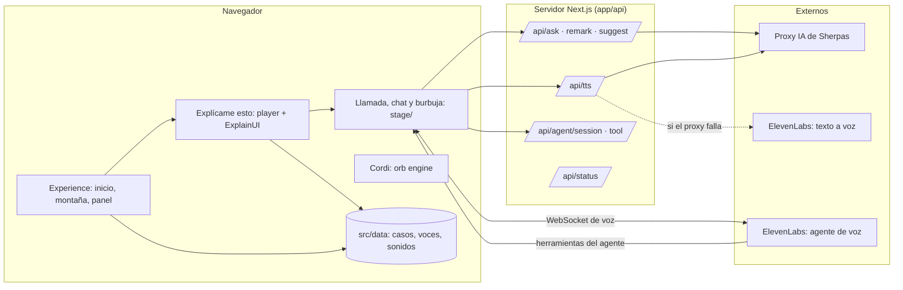
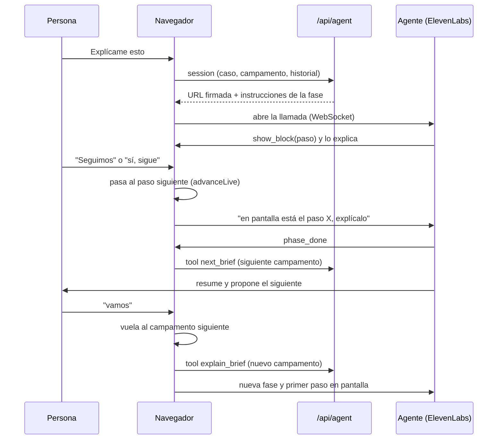

# Arquitectura de Cordada

Cordada convierte el análisis financiero que Sherpas hace de una familia en una montaña que se sube con Cordi, una guía con voz.

Todo el sistema es una sola app Next.js:
- **el navegador** pinta la montaña, mueve a Cordi y lleva las explicaciones;
- **unas pocas rutas de servidor** guardan las claves y hablan con los servicios de IA y de voz.

No hay base de datos: los datos de las familias van empaquetados con la app.

## 1. Vista general



Tres principios atraviesan todo:

1. **Las cifras salen solo de los datos del caso.** Las pantallas, las explicaciones y las instrucciones que reciben los modelos se construyen a partir de `src/data/cases.json`. Ningún modelo puede citar un número que no esté ahí.
2. **La app decide qué se ve; la IA solo habla.** Qué paso está en pantalla, cuándo se avanza y a qué campamento se va lo controla el código. El agente de voz explica en sus palabras, pero el avance lo hace la app, así que pantalla y voz no se desincronizan.
3. **Todo tiene un plan B.** Sin IA, sin voz o sin micrófono, la experiencia sigue:
   - frases de reserva cuando la IA no responde;
   - narraciones ya grabadas;
   - el chat en lugar de la llamada.

## 2. Estructura del repositorio

```
app/                    página única, layout y estilos (globals.css)
app/api/                rutas del servidor (sección 5)
src/Experience.tsx      raíz de la experiencia: inicio, barra superior, montaña, capas de Cordi
src/intro/              selector de perfil ("¿Quién sube hoy?")
src/expedition/         la montaña y la ruta
src/explain/            "Explícame esto": pasos, reproductor y gráficos
src/dashboard/scenes/   una escena interactiva por tema (panel del campamento y explicaciones)
src/stage/              llamada (local y agente), chat, burbuja de Cordi
src/orb/                Cordi: física, emociones y efectos
src/ai/                 cliente del navegador para las rutas de IA
src/server/             código solo de servidor: claves, contexto de Cordi, instrucciones del agente
src/data/               datos de los casos y manifiestos de voz y sonidos (JSON)
src/lib/                audio, textos y formato de cifras, store mínimo
public/audio/           narraciones y efectos ya grabados
docs/                   esta guía, el flujo de escenas y los benchmarks de modelos
```

## 3. Los datos

| Archivo | Qué es |
|---|---|
| `src/data/cases.json` | Las 4 familias de ejemplo de Sherpas con su análisis completo: temas, estados, puntuación y cifras. Se generó una vez a partir del MCP de Sherpas; el generador está en el tag `legacy-backend`. |
| `src/data/voice.json`, `sfx.json` | Manifiestos de las narraciones y los efectos ya grabados en `public/audio/`, con los tiempos de cada palabra. |
| `src/expedition/steps.ts` | Convierte un caso en la ruta. El campamento base es la puntuación. Siguen los temas, de terreno firme a los tramos más empinados. La cima es el movimiento que más los sube. |
| `src/explain/beats.ts` | Convierte cada campamento en pasos: una frase de Cordi más un gráfico. Usa reglas por tipo de tema, no casos fijos, así que sirve para cualquier familia que analice Sherpas. |
| `src/server/knowledge.ts` | Conocimiento general por tema: qué mide, qué es sano y qué palancas lo mueven. No contiene cifras de familias. |

`docs/matriz-escenas.md` explica cómo cada etiqueta posible de Sherpas tiene su animación, de modo que una familia nueva también queda cubierta.

## 4. El navegador

### 4.1 La montaña (`src/expedition/`)

- **`world.ts` y `render.ts`:** dibujan la montaña y la ruta en un canvas, enteras, en cada fotograma. Un segundo canvas (`world-front`) redibuja el pico por delante de Cordi durante la intro. Se desvanece en círculo, sin bordes rectos.
- **`Expedition.tsx`:** lleva la cámara, la intro, la vista de toda la montaña y la visita guiada. Cordi vive en coordenadas del mundo con su propio muelle, así que la cámara se mueve libre.
- **`Detail.tsx`:** el panel de cada campamento. Muestra la cifra clave, la escena interactiva (`src/dashboard/scenes/`) y el botón "Explícame esto".
- **Avance:** nada avanza solo dentro de la montaña. Solo "Empezar la visita guiada" arranca sola a los 4 s.

### 4.2 "Explícame esto" (`src/explain/`)

- **`player.ts`:** el reproductor. Su estado vive en el store `explain`:
  - `phase` (`off`, `playing` o `done`), el paso `i` y el modo `how` (`call` o `chat`);
  - `saying`, `waiting` y `paused`;
  - `fresh`: lo que Cordi dice ahora es el propio paso (sección 6);
  - `nextId`: el campamento siguiente.
- **Arranque y modo:** empieza siempre sin preguntar. La primera vez como llamada; después, en el modo que la persona usó la última vez (se guarda en `localStorage` como `cordada.how`).
- **`ExplainUI.tsx`:**
  - el escenario sobre la montaña, con los capítulos del paso y los controles (anterior, pausa, siguiente, repetir, "No lo entiendo");
  - "Seguimos", que se ilumina cuando Cordi termina el paso;
  - el interruptor Llamada/Chat.
  
  En llamada, debajo van el micrófono, el silencio de Cordi y una caja para escribir. En chat, al lado va la conversación completa (`Conversation.tsx`).
- **Fin del campamento:** la bandera se planta sola y aparece "Siguiente: X". `nextCampAfter()` decide cuál es el siguiente, y es la misma regla que usa el agente para proponerlo.
- **`Visual.tsx`:** los gráficos (cifra, barras, rango, puntuación, lista, escena). Se construyen según el avance de la voz, `speech.p`, de 0 a 1.
- **`remarks.ts` y `/api/remark`:** Cordi comenta por su cuenta lo que la persona hace sobre un gráfico. Si la IA no responde, aplica reglas locales.

### 4.3 Llamada, chat y burbuja (`src/stage/`)

Hay tres formas de hablar con Cordi, que comparten el mismo historial (`chat.ts`, store `chat`):

| Modo | Cómo funciona |
|---|---|
| **Llamada con el agente** (`agent.ts`) | WebSocket directo a ElevenLabs. Escucha, piensa y habla en tiempo real, y se le puede interrumpir. Es la opción por defecto si hay agente configurado. |
| **Llamada local** (`call.ts`) | El reconocimiento de voz del navegador escucha. La respuesta sale de `/api/ask` y la voz de `/api/tts`. Se usa cuando el agente no está disponible. |
| **Chat** (`Conversation.tsx`) | Preguntas escritas a `/api/ask`, con la respuesta escribiéndose palabra a palabra. Las sugerencias de preguntas salen de `/api/suggest`, o de un banco fijo si la IA no responde. |

- **Contexto compartido:** al abrir una llamada se le pasa al agente la conversación previa, y todo lo dicho en la llamada se guarda en el historial. Así, cambiar de modo no pierde el hilo.
- **La burbuja** (`Caption.tsx` y `stage.ts`):
  - **Narración** (intro y campamentos): muestra el texto de Cordi palabra a palabra con los tiempos de la voz. Toma desde la primera palabra el tamaño de la frase completa y se desliza en vez de saltar. En la intro va debajo de Cordi.
  - **En llamada:** no muestra texto, salvo que la persona silencie a Cordi; entonces aparecen subtítulos (sección 6).

### 4.4 Cordi (`src/orb/`)

`engine.ts` es un único objeto con un bucle de `requestAnimationFrame` que escribe transformaciones directamente, sin pasar por React. El cuerpo tiene:
- un muelle hacia su objetivo;
- una gelatina que reacciona a la aceleración;
- emociones y ojos.

Los toques hacen que salte, como mucho una vez cada 0,35 s. `fx.ts` dibuja estrellas, anillos y partículas en su propio canvas.

### 4.5 Estado

`src/lib/store.ts` es un store mínimo: el código imperativo escribe y React lee con `useSyncExternalStore`. Los principales:

| Store | Qué guarda |
|---|---|
| `explain` | Estado del reproductor |
| `chat` | Historial y estado del chat |
| `call` | Estado de la llamada, micrófono, silencio de Cordi |
| `agent` | Modo del agente: explicar o libre |
| `speech` | Avance de la frase actual (0 a 1) |
| `bubble` | Texto, frase completa y visibilidad de la burbuja |
| `nav` | Navegar a un campamento y explicarlo |
| `progress`, `known` | Hasta qué paso se llegó y qué se ha explicado |
| `understanding` | Qué entendió la persona en cada campamento |

## 5. El servidor (`app/api/` y `src/server/`)

Todas las claves viven en `.env` y solo se leen en el servidor (`src/server/env.ts`). Al navegador nunca llega ninguna.

| Ruta | Qué hace | Servicio |
|---|---|---|
| `POST /api/ask` | Responde una pregunta con el análisis de la familia, dónde está la persona y la conversación reciente. Las instrucciones las arma `cordi.ts`. | Proxy de Sherpas |
| `POST /api/remark` | Comentario breve, o pregunta con opciones, sobre lo que la persona acaba de hacer | Proxy de Sherpas |
| `POST /api/suggest` | Tres preguntas sugeridas para el momento | Proxy de Sherpas |
| `POST /api/tts` | Voz de cualquier frase. Se guarda en `.cache/voice`, así que cada frase se paga una sola vez. | Proxy de Sherpas; ElevenLabs directo si falla |
| `POST /api/agent/session` | Abre la llamada: URL firmada y temporal del agente, más quién es la familia y las instrucciones de la primera fase | ElevenLabs |
| `POST /api/agent/tool` | Herramientas del agente que necesitan el plan (sección 7) | — |
| `GET /api/status` | Qué está activo (IA, voz, agente), sin revelar claves | — |

`src/server/llm.ts` pide modelos por nivel, no por nombre:
- **`fast`:** `gemini-3.5-flash-lite`, y si falla `gpt-5-mini`.
- **`quality`:** el orden inverso.

Cada nivel prueba sus modelos en orden si hay un error, se agota el tiempo o la respuesta llega vacía. Los modelos se eligieron midiendo (`docs/benchmarks/`).

## 6. Sincronizar voz, gráficos y texto

- **Avance de la voz:** `speech.p` (0 a 1) es cuánto de la frase actual se ha dicho. Lo actualizan:
  - el agente, carácter a carácter con los tiempos de su audio;
  - la llamada local, con el tiempo real del audio;
  - el chat, palabra a palabra.
- **Los gráficos se construyen solo con el propio paso.** `fresh` está activo mientras Cordi narra el paso: lo enciende `show_block` del agente o `sayBeat` del reproductor, y se apaga cuando termina.
  - Lo demás que Cordi diga en ese paso ("¿sigues ahí?", una respuesta) deja el gráfico completo y quieto.
  - Un paso aún no narrado espera vacío. Si en 4 s no llega la narración, se muestra completo.
- **Subtítulos con Cordi silenciado:** cada carácter tiene una hora: el inicio de su trozo de audio, más su desfase, más la latencia de salida del dispositivo. Un único bucle por fotograma muestra lo que toca, y cada palabra aparece cuando empieza a decirse.
- **Pausa con el agente:** el SDK no tiene pausa. Mientras dura, el agente recibe la orden de callar, su volumen va a 0, el micrófono se silencia y una señal de actividad cada segundo evita que pregunte si sigues ahí. Al quitar la pausa todo vuelve como estaba.

## 7. La llamada con el agente, de punta a punta

Los agentes son "Cordada guide" (español, voz Raquel) y "Cordada guide (English)" (voz Sarah) en ElevenLabs, con `gemini-3.1-flash-lite` y la voz en `eleven_v4` a 24 kHz (con `eleven_flash_v2_5` y 16 kHz sonaba robótica). Su configuración fija (instrucciones base y herramientas) se escribió con `scripts/agent.ts`, que está en el tag `legacy-backend`. Para cambiarla hay que tocarla en ElevenLabs.



Herramientas del agente:

| Herramienta | Qué hace |
|---|---|
| `show_block` | Pone un paso en pantalla. Solo puede avanzar si la persona lo pidió. |
| `lookup` | Cifras de un tema. En el mapa, solo de lo ya explicado. |
| `phase_done` | Cierra el campamento. Devuelve las instrucciones de "guía del mapa", que piden proponer solo el siguiente campamento: el mismo del botón. |

`explain_brief` no es una herramienta del agente: la pide la app al llegar a un campamento con la llamada abierta y se la pasa al agente. Las instrucciones por fase las arman `src/server/brief.ts` (dentro de un campamento) y `src/server/map.ts` (en el mapa).

## 8. Qué cuesta y quién lo paga

| Parte | Cuenta | Coste |
|---|---|---|
| Llamada con el agente | ElevenLabs del equipo | Por minuto según el plan; el modelo, unos 0,004 USD/min |
| Chat, comentarios y sugerencias | Proxy de IA de Sherpas | Bajo: modelos lite y textos cortos |
| Voz de narraciones y llamada local | Proxy de Sherpas, ElevenLabs si falla | Cada frase se paga una vez (`.cache/voice`) |

## 9. Configuración

`.env` (plantilla en `.env.example`):

| Variable | Para qué |
|---|---|
| `LLM_PROXY_URL`, `TEAM_KEY` | Proxy de IA de Sherpas |
| `ELEVENLABS_API_KEY`, `ELEVENLABS_AGENT_ID` | Agente en vivo y voz de reserva |
| `VOICE_ID` | Voz de Cordi |
| `VOICE_MODEL_LIVE` | Modelo de voz (opcional) |

Arranque: `npm install`, después `npm run dev` (puerto 3100). Para comprobar: `npm run typecheck` y `npm run build`.

## 10. Historia

1. **Primera arquitectura: un backend aparte.** Era una API Hono con un motor de fases y Postgres, y el front estaba en otro repositorio.
2. **Prototipo.** Después vino un prototipo en un solo HTML (`web/orb`).
3. **App actual.** Por último esta app, que empezó en `MCPV2/` y ahora es el repositorio entero.

Todo lo anterior está en el tag `legacy-backend` (`git checkout legacy-backend -- <ruta>` para recuperar algo).
